# TodoNiel


> **🚧 Projeto em desenvolvimento**
>
> Este repositório contém o protótipo do design e o código ainda está em construção. Tudo o que estiver marcado como **planejado** ainda não está pronto. A autenticação está simplificada nesta fase, sem JWT; o uso de hash de senha via bcrypt está previsto. Não use dados reais.

## Sobre o projeto

TodoNiel é um gerenciador de tarefas inspirado no Todoist, com foco em datas de entrega e calendário. A proposta é ajudar a identificar tarefas atrasadas, próximas do prazo ou no prazo. O design das telas está disponível como protótipo; os recursos do aplicativo ainda estão planejados.

## Status do desenvolvimento

- [x] Design gráfico das telas (protótipo)
- [ ] Login e registro
- [ ] Cadastro de tarefas
- [ ] Tarefas no calendário
- [ ] Status de prazo: atrasado, perto do prazo e no prazo
- [ ] Redefinição de senha com código numérico
- [ ] Grupos: criar, entrar por código, calendário do grupo e membros
- [ ] E-mails de lembrete de 4 a 1 dia antes do prazo
- [ ] Feedback com estrelas
- [ ] Segurança: bcrypt e sessões

## Funcionalidades

**Implementadas:** o protótipo gráfico das telas está disponível em `docs/desigin/jpgs/`. Não foi encontrado código de funcionalidades do aplicativo neste diretório.

**Planejadas:** cadastro e acompanhamento de tarefas com datas, calendário e status de prazo; grupos em que cada membro marca a própria conclusão; lembretes por e-mail; feedback com estrelas; e redefinição de senha por código numérico.

## Protótipo (design)

As imagens abaixo mostram o protótipo gráfico; elas não representam funcionalidades já implementadas.

### Acesso e conta

<table>
  <tr>
    <td>
      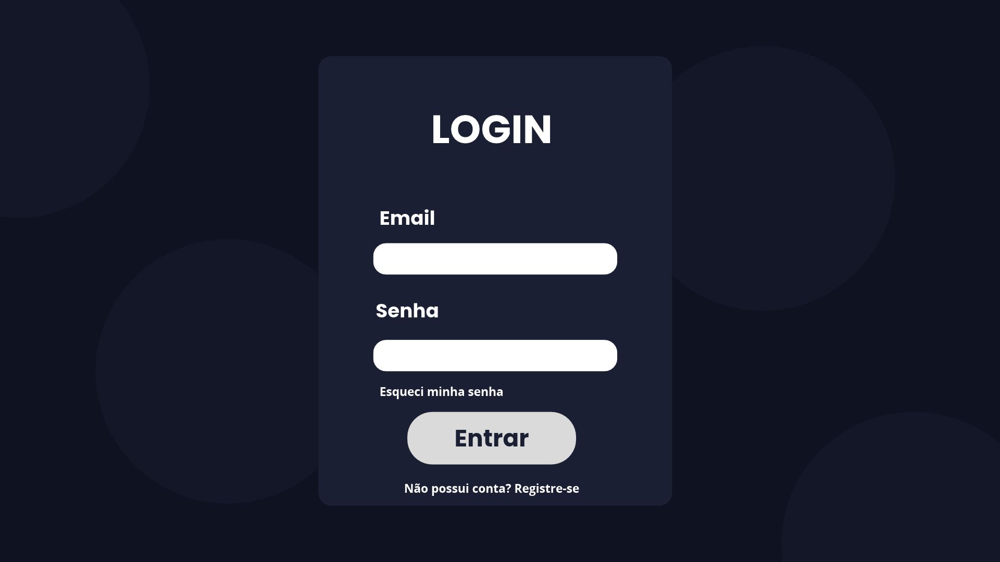
      <p><strong>Login</strong> — e-mail e senha, link “Esqueci minha senha” e link para o registro.</p>
    </td>
    <td>
      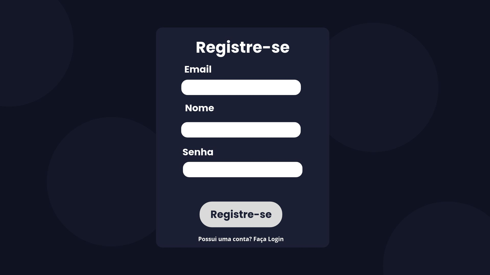
      <p><strong>Registro</strong> — e-mail, nome e senha.</p>
    </td>
  </tr>
  <tr>
    <td>
      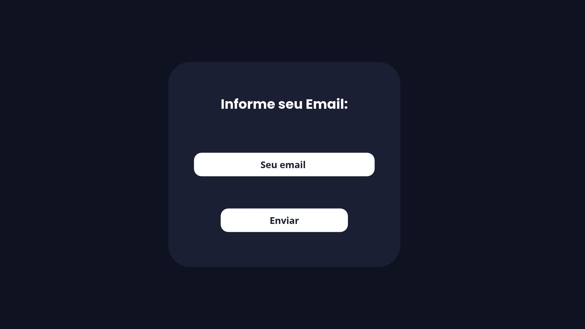
      <p><strong>Redefinição de senha — passo 1</strong> — informar o e-mail.</p>
    </td>
    <td>
      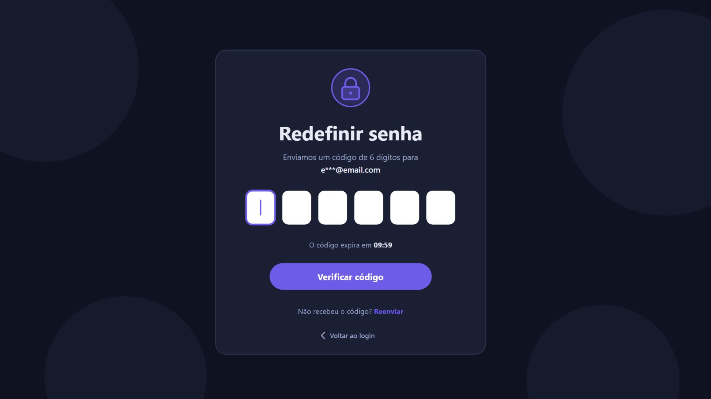
      <p><strong>Redefinição de senha — passo 2</strong> — informar o código numérico de 6 dígitos.</p>
    </td>
  </tr>
</table>

### Tarefas e calendário

<table>
  <tr>
    <td>
      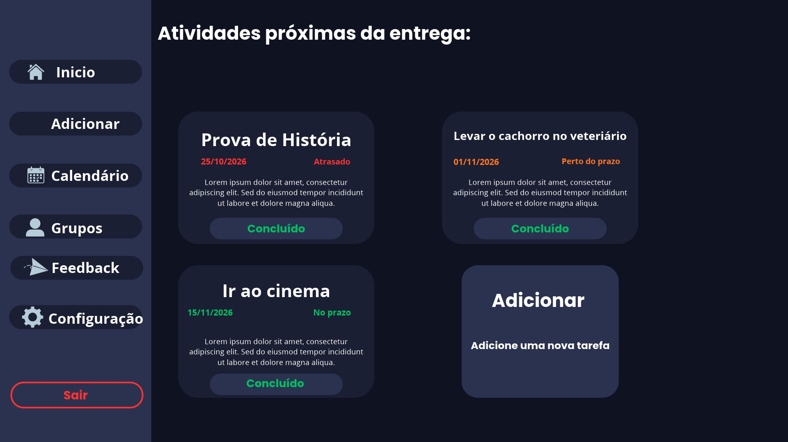
      <p><strong>Início</strong> — atividades próximas da entrega, status por cor e botão “Concluído”.</p>
    </td>
    <td>
      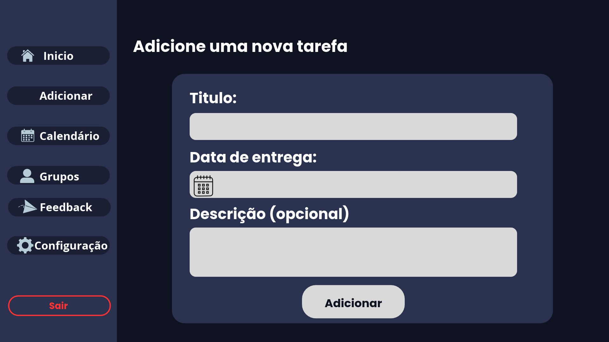
      <p><strong>Adicionar tarefa</strong> — título, data de entrega e descrição opcional.</p>
    </td>
  </tr>
  <tr>
    <td>
      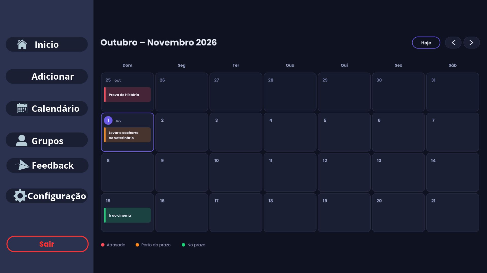
      <p><strong>Calendário</strong> — tarefas coloridas de acordo com o status.</p>
    </td>
    <td></td>
  </tr>
</table>

### Grupos

<table>
  <tr>
    <td>
      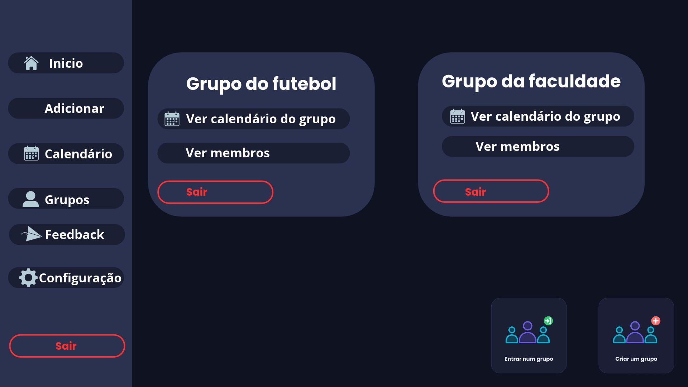
      <p><strong>Grupos</strong> — cards com opções para ver calendário e membros ou sair, além de atalhos para entrar ou criar grupo.</p>
    </td>
    <td>
      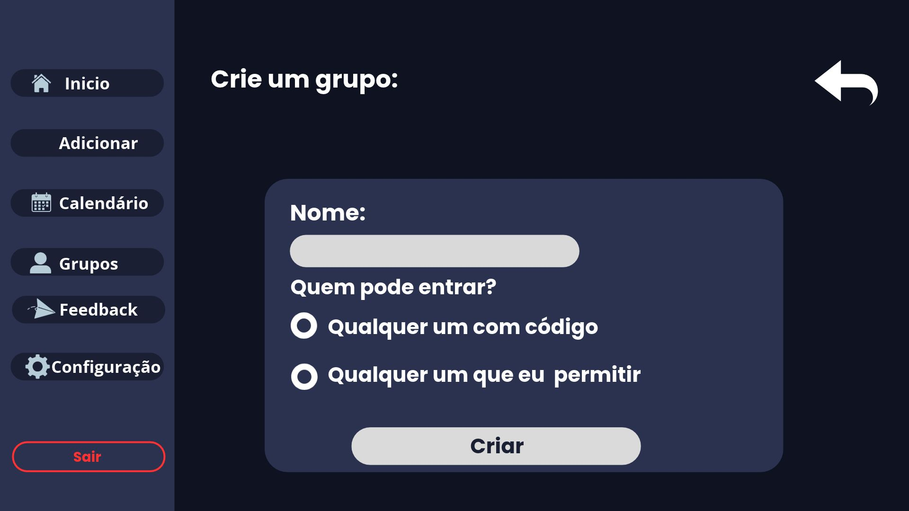
      <p><strong>Criar grupo</strong> — nome e escolha de quem pode entrar: qualquer pessoa com o código ou pessoas permitidas.</p>
    </td>
  </tr>
  <tr>
    <td>
      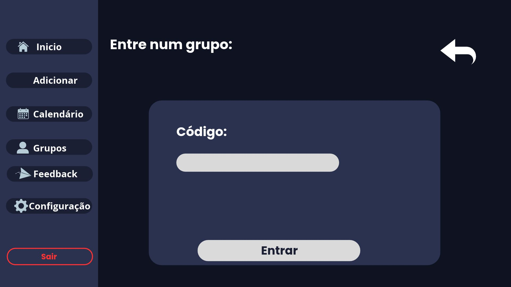
      <p><strong>Entrar em grupo</strong> — informar o código do grupo.</p>
    </td>
    <td></td>
  </tr>
</table>

### Feedback e configurações

<table>
  <tr>
    <td>
      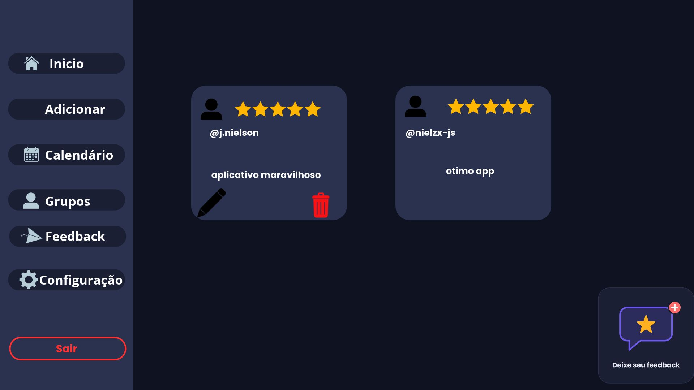
      <p><strong>Feedbacks</strong> — lista de avaliações com estrelas e opções de editar ou excluir os próprios feedbacks.</p>
    </td>
    <td>
      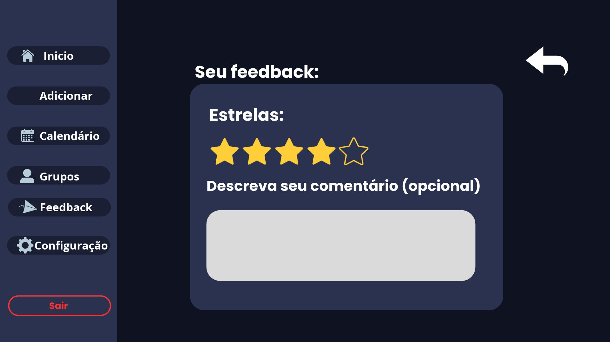
      <p><strong>Deixar feedback</strong> — avaliação com estrelas e comentário opcional.</p>
    </td>
  </tr>
  <tr>
    <td>
      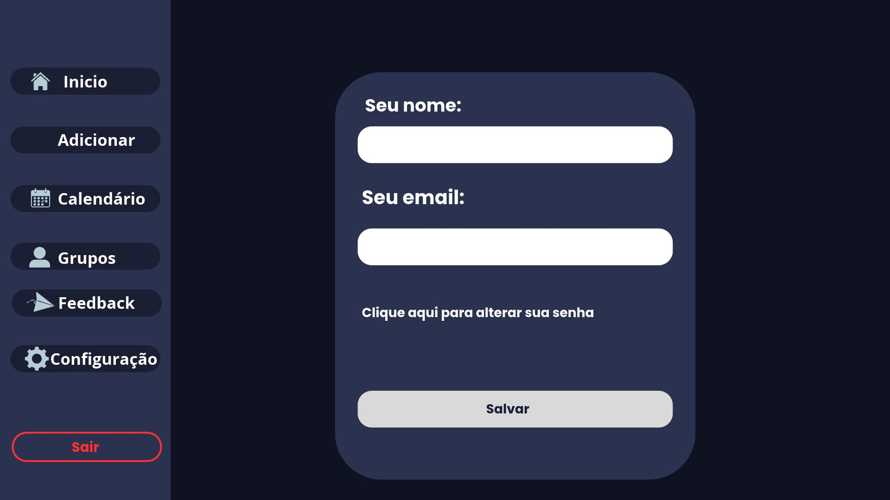
      <p><strong>Configurações</strong> — nome, e-mail e opção para alterar a senha.</p>
    </td>
    <td></td>
  </tr>
</table>

[Ver o PDF completo do design](docs/desigin/todoist.pdf).

## Paleta de cores

| Nome | Uso | Código |
|---|---|---|
| Fundo | Fundo principal | `#0F1220` |
| Superfície | Cards e áreas elevadas | `#1A1F33` |
| Borda | Contornos e divisórias | `#2B3250` |
| Primária | Ações e elementos principais | `#6C5CE7` |
| Secundária | Elementos de apoio | `#00B8D9` |
| Destaque | Destaques visuais | `#FF6B6B` |
| Texto | Texto principal | `#E8EAF6` |
| Texto secundário | Texto auxiliar | `#9AA3C7` |
| Sucesso | Estado de sucesso | `#2ECC71` |
| Alerta | Avisos | `#F5A623` |
| Erro | Erros | `#E5484D` |

## Tecnologias

Não foi localizado um `package.json` neste diretório. Portanto, ainda não há dependências ou stack de implementação que possam ser confirmadas.

Previstas:

- FullCalendar (planejado)
- Nodemailer (planejado)
- node-cron (planejado)
- express-session (planejado)
- bcrypt (planejado)

## Como rodar localmente

**TODO:** não é possível iniciar o aplicativo neste estado do repositório. Não foram encontrados `package.json`, `.env.example`, arquivos SQL nem scripts de inicialização.

Quando esses arquivos estiverem disponíveis, completar e validar os passos abaixo:

1. Clonar o repositório — **TODO:** informar a URL do repositório.
2. Instalar as dependências — **TODO:** confirmar o gerenciador e o comando nos scripts do `package.json`.
3. Criar o arquivo `.env` a partir de `.env.example` — **TODO:** adicionar o exemplo e documentar as variáveis necessárias.
4. Criar o banco MySQL — **TODO:** adicionar os scripts SQL e informar o nome e as instruções do banco.
5. Iniciar o servidor — **TODO:** definir e documentar o script de inicialização.

## Estrutura de pastas

Estrutura resumida encontrada:

```text
sistema_TODOIST/
└── docs/
    └── desigin/
        ├── jpgs/
        │   ├── ADD_TAREFA.jpg
        │   ├── CALENDARIO.jpg
        │   ├── CODIGO.jpg
        │   ├── CODIGO_GRUPO.jpg
        │   ├── CONFIG.jpg
        │   ├── CRIAR_GRUPO.jpg
        │   ├── FEEDBACK.jpg
        │   ├── GRUPOS.jpg
        │   ├── INICIO.jpg
        │   ├── LOGIN.jpg
        │   ├── REGISTRO.jpg
        │   ├── SEUEMAIL.jpg
        │   └── SEUFEEDBACK.jpg
        └── todoist.pdf
```

## Próximos passos

1. Login e registro
2. Tarefas com calendário
3. Status de prazo
4. Grupos
5. E-mails de lembrete
6. Feedback e redefinição de senha

## Autor

Nyel — [GitHub](https://github.com/nielzx-js)

## Licença

A definir.
